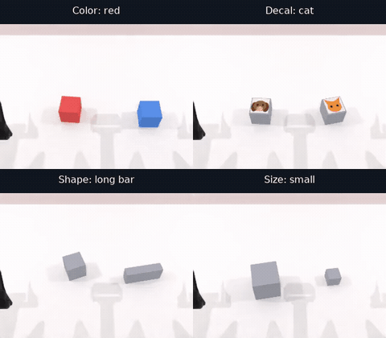

# robotwin-if — Press/Lift Stapler v1

基于 [RoboTwin 2.0](https://github.com/RoboTwin-Platform/RoboTwin) 的六任务 instruction-following benchmark：分别检查动作、目标物体、属性、机械臂、堆叠顺序和空间关系。
当前 Verb 任务为 **Press / Lift Stapler**：同一初始场景、相同对象短语，只改变动作指令。

**当前版本：随机朝向 Stapler v1 · 每任务 20 blocks · 六个开源 checkpoint · 2760 回合、720 blocks 全部完成。**
评测于 2026-10-26 11:53 UTC 完成校验。

[固定 seed 清单](seed-manifests/robotwin-if-press-lift-stapler-v1-20-per-mode/README.md) ·
[完整结果](result/robotwin-if-press-lift-stapler-v1-20blocks/README.md) ·
[六任务视频](#task-demos) · [运行评测](#run-evaluation) · [历史文档 archive](docs/archive/README.md)

| 诊断轴 | Task | 指令对照 |
|---|---|---|
| Verb-Select | [`press_lift_stapler`](#press-lift-stapler) | press / lift |
| Noun-Grounding | [`pick_diverse_object`](#pick-diverse-object) | 按物体名称选择；分别覆盖 seen / unseen 物体池 |
| Attribute-Select | [`attribute_select`](#attribute-select) | color / decal / shape / size，每种属性两个目标值 |
| Arm-Select | [`arm_select`](#arm-select) | left arm / right arm |
| Sequence | [`stack_sequence`](#stack-sequence) | 红、绿、蓝三个方块的六种自下而上顺序 |
| Spatial-Direction | [`place_relative`](#place-relative) | left / right / on top |

任务、干扰物、指令、成功判据和评测适配由本仓库维护；开源 checkpoint 直接用于推理。
RoboTwin 通过 submodule 固定版本，任务通过软链安装；模型服务与仿真分别使用独立环境。

<a id="policy-results"></a>

## 六个开源 checkpoint 的评测结果

每个模型完成 **460 回合、120 blocks**。Stapler 新跑 240 回合，其余五任务复用既有的 2520 回合；成功和已完成的 policy failure 全部保留。

| Policy | Verb Stapler | Noun | Attribute | Arm | Sequence | Spatial | Overall (%) |
|---|---:|---:|---:|---:|---:|---:|---:|
| [X-VLA](policies/xvla/README.md) | 24/40 | 15/40 | 73/160 | 5/40 | 0/120 | 6/60 | 27.6 |
| [LingBot-VA](policies/lingbot_va/README.md) | 18/40 | 30/40 | 108/160 | 37/40 | 17/120 | 26/60 | 56.2 |
| [LingBot-VLA](policies/lingbot_vla/README.md) | 19/40 | 13/40 | 77/160 | 18/40 | 14/120 | 3/60 | 31.6 |
| [VLAct All](policies/vlact/README.md) | 36/40 | 28/40 | 108/160 | 29/40 | 15/120 | 19/60 | 57.4 |
| [DM05](policies/dm05/README.md) | 32/40 | 25/40 | 88/160 | 25/40 | 9/120 | 20/60 | 50.1 |
| [Hy-VLA](policies/hy_vla/README.md) | 35/40 | 11/40 | 83/160 | 17/40 | 15/120 | 7/60 | 38.9 |

任务列为成功数 / 已评测回合数。**Overall 对六个任务的成功率等权平均，每个任务内部各 mode 等权**，不是 460 回合的合并成功率。
X-VLA 使用公开 clean checkpoint，其余五个模型使用对应的 clean + randomized checkpoints；VLAct 为 All 100K。
具体版本和权重身份见 [checkpoints.json](result/robotwin-if-press-lift-stapler-v1-20blocks/checkpoints.json)。

### Press / Lift 配对结果

两条指令固定为 `Press down on the stapler.` 和 `Lift the stapler.`。
每个模型评测 20 个配对场景；“同场景双成功”表示该场景下的两个独立回合分别正确执行 Press 和 Lift。

| Policy | Press | Lift | 同场景双成功 |
|---|---:|---:|---:|
| X-VLA | 9/20 | 15/20 | 7/20 |
| LingBot-VA | 18/20 | 0/20 | 0/20 |
| LingBot-VLA | 18/20 | 1/20 | 1/20 |
| VLAct All | 20/20 | 16/20 | 16/20 |
| DM05 | 20/20 | 12/20 | 12/20 |
| Hy-VLA | 17/20 | 18/20 | 17/20 |

[六任务分模式成绩](result/robotwin-if-press-lift-stapler-v1-20blocks/results.md) ·
[HTML 报表](result/robotwin-if-press-lift-stapler-v1-20blocks/results.html) ·
[逐回合 CSV](result/robotwin-if-press-lift-stapler-v1-20blocks/episodes.csv) ·
[Press/Lift 配对统计](result/robotwin-if-press-lift-stapler-v1-20blocks/stapler-summary.json)

本版替换了 Verb 任务，Overall 与旧版的变化不能视为同一任务上的能力提升。
Hy-VLA 的 Noun seed `100052` 自动标签与用户视频复核存在分歧；当前成绩保留原标签，该回合未用于下方展示，见[复核记录](docs/assets/task-demos/README.md)。

<a id="task-demos"></a>

## 六个任务与当前评测视频

下方 14 个示例全部来自当前结果包中的成功回合，包含本轮新跑的 Stapler 和原样复用的其余五任务。
视频仅用于说明任务行为，完整成功率以上方表格为准。GIF 可直接预览，点击打开 MP4；[素材来源](docs/assets/stapler-v1-demos/README.md)记录指令、seed、checkpoint 对应模型与原始文件哈希。

<a id="press-lift-stapler"></a>

### 1. Press / Lift Stapler：按动词执行动作

同一订书器、同一组干扰物和机器人初始状态，分别执行 **Press** 与 **Lift**。
订书器位置和朝向随 scene seed 改变；订书器 yaw 为 ±15°，鼠标与玩具车的干扰位置随机、yaw 各自为 ±180°，同一配对场景共享这些采样结果。
场景不设置放置目标垫。判据锁定第一个完成的动作：先完成错误动作，再做正确动作仍失败。
Press 要求闭合夹爪的向下按压接触；Lift 要求抓持抬升至少 3 cm、离开桌面至少 0.1 秒。详见[任务场景与成功判据](docs/press-lift-stapler-experiment.md)。

[](docs/assets/stapler-v1-demos/press_lift_stapler.mp4)

[观看 MP4](docs/assets/stapler-v1-demos/press_lift_stapler.mp4) · VLAct All · seeds `110000 / 110001` · 左 Press，右 Lift。

<a id="pick-diverse-object"></a>

### 2. Noun-Grounding：按名称找到物体

桌上放置四个不同类别的物体，按指令中的物体名选择并抓起目标。
Seen 与 Unseen 使用不同物体池，是两个独立场景；每个场景内的候选物体属于同一 familiarity group。

[](docs/assets/stapler-v1-demos/pick_diverse_object.mp4)

[观看 MP4](docs/assets/stapler-v1-demos/pick_diverse_object.mp4) · 左：DM05，seed `100014`；右：Hy-VLA，seed `100053`。

<a id="attribute-select"></a>

### 3. Attribute-Select：按视觉属性选择目标

按颜色、图案、形状或大小，在两个物体中选择目标。每种属性的两个目标指令共享场景；一个 block 共四组对照、八个回合。
目标当前抬升须超过 5 cm，且干扰物整回合从未越过该高度；先抓错再抓对仍失败。详见[当前判据](docs/attribute-select-target-only.md)。

[](docs/assets/stapler-v1-demos/attribute_select.mp4)

[观看 MP4](docs/assets/stapler-v1-demos/attribute_select.mp4) · Hy-VLA · seeds `100008 / 100010 / 100013 / 100015` · 从左上到右下：red、cat、long bar、small。

<a id="arm-select"></a>

### 4. Arm-Select：使用指定机械臂

对同一 5 cm 方块，分别要求使用左臂或右臂拿起。方块在双臂共用区域内随机平移和旋转，配对回合共享布局。
指定臂须将方块抬升超过 5 cm；先用错误臂拿起、再换指定臂仍失败。详见[场景](docs/recon/arm-select-cube-v3.md)和[当前判据](docs/arm-select-target-arm-only.md)。

[](docs/assets/stapler-v1-demos/arm_select.mp4)

[观看 MP4](docs/assets/stapler-v1-demos/arm_select.mp4) · LingBot-VA · seeds `500000 / 500001`。

<a id="stack-sequence"></a>

### 5. Sequence：按指定顺序堆叠

将红、绿、蓝三个方块按指令要求的自下而上顺序堆成三层。
同一场景对应六种排列；堆成塔但颜色顺序错误不算成功。

[](docs/assets/stapler-v1-demos/stack_sequence.mp4)

[观看 MP4](docs/assets/stapler-v1-demos/stack_sequence.mp4) · VLAct All · seeds `100014 / 100017` · 从底向上 R→G→B / G→B→R · 相对存档视频 3× 播放。

<a id="place-relative"></a>

### 6. Spatial-Direction：理解相对方向

将物体 A 放到参考物体 B 的 left、right 或 on top，场景中另有一个干扰物。
同一布局对应三个指令；下例将绿色 toycar 放到红色 tea-box 左侧或顶部。

[](docs/assets/stapler-v1-demos/place_relative.mp4)

[观看 MP4](docs/assets/stapler-v1-demos/place_relative.mp4) · VLAct All · seeds `100055 / 100059` · 相对存档视频 1.5× 播放。

## 固定 seed 与复现

当前清单为 [`robotwin-if-press-lift-stapler-v1-20-per-mode`](seed-manifests/robotwin-if-press-lift-stapler-v1-20-per-mode/README.md)。
每任务 20 个完整 blocks；Stapler 的 `110000–110039` 共 40 个 seeds 经过 expert 筛选，配对初始 RGB、机器人状态和物体位姿一致。
其余五份 seeds 及资格证据原样保留。

| Task | 每 block 回合数 | 每模型回合数 | 动作预算 | Task config |
|---|---:|---:|---:|---|
| press_lift_stapler | 2 | 40 | 250 | demo_clean |
| pick_diverse_object | 2 | 40 | 400 | demo_clean |
| attribute_select | 8 | 160 | 400 | demo_clean |
| arm_select | 2 | 40 | 400 | demo_clean_arm_select_v3 |
| stack_sequence | 6 | 120 | 1200 | demo_clean |
| place_relative | 3 | 60 | 400 | demo_clean |
| 合计 | 23 | 460 | | |

所有模型按 manifest 的原始 seed 顺序评测。Policy failure 保留；初始化或基础设施错误不替换 seed。
[`seed-modes.csv`](seed-manifests/robotwin-if-press-lift-stapler-v1-20-per-mode/seed-modes.csv) 和
[`seed-modes.json`](seed-manifests/robotwin-if-press-lift-stapler-v1-20-per-mode/seed-modes.json)给出每个回合的 mode、block 和场景信息。

```bash
python tools/export_seed_modes.py --check
python seed-manifests/robotwin-if-press-lift-stapler-v1-20-per-mode/verify.py
(cd result/robotwin-if-press-lift-stapler-v1-20blocks && sha256sum -c SHA256SUMS)
```

以上检查无需运行模型或仿真。新环境仍可能有渲染和推理随机性差异，固定 seed 不保证成功数逐次完全相同。

<a id="run-evaluation"></a>

## 运行评测

需要 Linux、NVIDIA GPU、RoboTwin 环境和资产，以及所选模型的独立推理环境。
首次安装按[环境搭建](docs/features/01-环境搭建.md)和[六模型交付说明](docs/branch-delivery.md)完成：

```bash
git submodule update --init third_party/robotwin
bash setup_robotwin.sh
conda activate RoboTwin
bash scripts/bridge_tasks.sh
bash scripts/bridge_tasks.sh --check
```

Arm 使用单独的 cube-v3 配置；首次安装、目标文件尚不存在时执行：

```bash
ln -s "$PWD/tasks/task_config/demo_clean_arm_select_v3.yml" \
  third_party/robotwin/task_config/demo_clean_arm_select_v3.yml
```

Bridge 安装任务、helper 和指令软链；实际评测成员由 [IF inventory](eval_cfg/if_tasks.yml) 与当前 manifest 指定。
外部 RoboTwin 可通过 `--robotwin-dir` 接入，版本兼容检查和配置方法见[bridge 使用说明](docs/task-bridge.md)。

按 [policies/](policies/README.md) 中所选模型的说明启动服务后，运行：

```bash
# 先查看当前六任务的命令，不启动评测。
bash scripts/eval.sh --policy vlact --output-dir outputs/policy-eval/vlact-new --dry-run

# 每任务 20 blocks，共 460 回合。
bash scripts/eval.sh --policy vlact --sim-gpu 0 --model-gpu 1 \
  --output-dir outputs/policy-eval/vlact-new

# 也可先用两个完整 Stapler blocks 检查接入。
bash scripts/eval.sh --policy vlact --task press_lift_stapler --blocks 2 \
  --sim-gpu 0 --model-gpu 1 --output-dir outputs/policy-eval/vlact-stapler-pilot
```

默认入口为一个模型服务、串行仿真。双路并发、复用其余五任务与完整运行校验见[正式评测说明](docs/formal-policy-evaluation.md)。
输出按 `<output-dir>/<policy>/<task>/` 保存，包含视频、动作、指令、逐回合结果与诊断。

## 完整视频与文档

本轮完整视频及动作位于原始运行目录：
`/Data/robotwin-if/evaluations/robotwin-if-press-lift-stapler-v1-20blocks-001/`。
本机已有视频复核页：<http://127.0.0.1:8897/>；远程访问需转发端口。
使用其他副本时可按[视频复核工具](tools/policy-video-review/README.md)启动服务。
README 中的示例 GIF/MP4 随仓库保存，可独立查看。

| 内容 | 入口 |
|---|---|
| 六模型安装、权重、服务与 eval adapter | [policies](policies/README.md) |
| 任务 inventory、mode 与 block 定义 | [eval_cfg](eval_cfg/README.md) |
| 生成和消费 qualified seed manifest | [seed manifest 使用指南](docs/seed-manifest-usage.md) |
| 当前任务场景、指令与判据 | [Press/Lift Stapler](docs/press-lift-stapler-experiment.md) |
| 当前发布及历史结果复用证据 | [发布溯源](docs/release-provenance.md) |
| 旧版 Bottle README、过渡版快照与早期 pilot | [docs/archive](docs/archive/README.md) |

`seed-manifests/` 和 `result/` 各保留当前 Stapler v1 一套发布；旧版说明保存在 archive 文档中，旧发布原件可从 `master-261027-staper-v1` 备份分支恢复。
