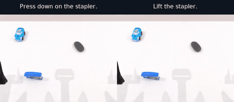
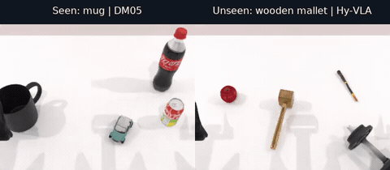
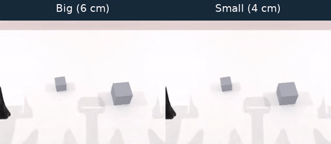
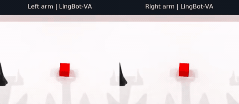
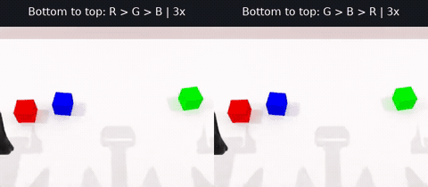
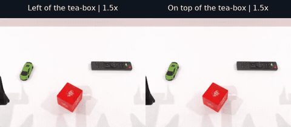

# robotwin-if — Stapler v2 · Size 6 cm

robotwin-if 是基于 [RoboTwin 2.0](https://github.com/RoboTwin-Platform/RoboTwin) 构建的六任务 instruction-following benchmark，
核心问题是：**面对相同的初始画面，VLA 模型能否根据不同的语言指令，选择并完成相应的行为？**

在原生操控任务中，物体与场景布置往往已经强烈暗示要执行什么动作，完成任务可能同时依赖场景识别和语言理解。
我们将可执行的不同目标放入共享场景，通过改变指令中的动作、物体、属性、机械臂、顺序或空间关系，检查语言能否实际改变模型的选择。
当前 Verb 任务 **Press / Lift Stapler** 就是一个直接例子：同一只订书器、同一幅初始画面，分别要求按压和拿起。

**当前版本：Stapler v2 · Attribute Size 大块 6 cm / 小块 4 cm · 每任务 20 blocks · 六个开源 checkpoint。**
完整成绩为 2760 回合、720 blocks：2026-10-29 完成的 240 回合 Size 重测，合并 v1 中未变化的 2520 回合。
[尺寸实验与成绩变化](docs/attribute-size-6cm-ablation.md) · [旧 8 cm 成绩](result/robotwin-if-press-lift-stapler-v1-20blocks/README.md)（tag `stapler-v1.0.0`）。

[固定 seed 清单](seed-manifests/robotwin-if-press-lift-stapler-v1-20-per-mode/README.md) ·
[完整结果](result/robotwin-if-press-lift-stapler-v2-size6cm-20blocks/README.md) ·
[六任务视频](#task-demos) · [运行评测](#run-evaluation) · [历史文档 archive](docs/archive/README.md)

## 任务如何构造

**从原生任务已有的原子技能出发。** 设计目标是让模型在训练中接触过的基本动作之间按指令做选择。
选型时优先从 RoboTwin 原生 50 个任务的演示中提取抓取、抬升、按压、放置和堆叠等子动作，再组成新的指令对照。
例如，Stapler 的 Press 参考 `press_stapler`，Lift 取自 `move_stapler_pad` 的抓持抬升阶段，省去后续搬运和放置。
“原生演示中出现过”是选型依据；具体 checkpoint 的训练覆盖与动作掌握程度仍需结合模型说明和能力检查确认。

**共享初始状态，让指令决定目标。** 对同场景对照，场景采样与指令取值分开控制：同一组回合共享物体、布局和机器人初态，改变被测试的语言因素。
**当前除 Noun 外的五项任务，均已验证同场景对照的初始画面 pixel-equal**：头部与双腕相机的 RGB 逐像素一致，机器人初始状态也逐数组一致。
Stapler 的 20 对 Press/Lift 还在 seed 资格筛选中核对了物体位姿，保留了[原配对校验证据](seed-manifests/robotwin-if-press-lift-stapler-v1-20-per-mode/qualification-summary.json)；Size 的 20 对也已在 6 cm 设置下重新通过 expert 和初始观测校验，见[实验记录](docs/attribute-size-6cm-ablation.md)。
两条指令保留相同对象短语 `the stapler`，只改变动作短语：
`Press down on the stapler.` / `Lift the stapler.`。仅凭初始图像无法区分这两个目标，模型需要利用指令作出选择。

**用共享干扰物减弱场景对某个原生任务的提示。** 场景布置尽量避免与某一个原生任务一一对应，减少“看到这幅画面就执行惯用动作”的线索。
例如，Stapler 场景加入鼠标和玩具车作为背景干扰物（distractors），并移除会提示搬运目标的垫子；同时沿用原生资产与可达区域，控制额外的操控难度。
目标和干扰物的位置、朝向在不同场景间随机变化，在同一组指令对照中保持一致，避免干扰物本身泄露指令取值。

**先验证可行性，再冻结评测。** 任务设计先经过 expert/oracle、成功判据反例和少量模型能力检查；正式 manifest 只按 expert 与场景资格筛选完整 blocks，
不根据模型表现挑选 seeds。冻结后，所有 checkpoint 使用同一清单，成功和失败全部保留。
结果同时关注各 mode 成功率与同场景成组成功情况，以区分“某种动作能做到”和“能随指令切换行为”；单次失败仍需结合动作能力和执行轨迹解释。

六项任务的对照单位如下。**Noun 的 Seen/Unseen 是独立物体池、独立场景，不属于 pixel-equal 配对**；Attribute 则在同一属性的两个目标值之间共享场景。

| 诊断轴 | Task | 指令对照 | 场景与对照单位 |
|---|---|---|---|
| Verb-Select | [`press_lift_stapler`](#press-lift-stapler) | press / lift | 同场景两回合；初始观测逐数组校验 |
| Noun-Grounding | [`pick_diverse_object`](#pick-diverse-object) | 按物体名称选择 | Seen / Unseen 各一回合，使用独立场景 |
| Attribute-Select | [`attribute_select`](#attribute-select) | color / decal / shape / size | 每种属性两个目标值共享场景；共四对、八回合 |
| Arm-Select | [`arm_select`](#arm-select) | left arm / right arm | 同一方块布局，两回合 |
| Sequence | [`stack_sequence`](#stack-sequence) | 三个方块的六种自下而上顺序 | 同一布局，六回合 |
| Spatial-Direction | [`place_relative`](#place-relative) | left / right / on top | 同一布局，三回合 |

初始观测核验：v1 已直接比较六个 checkpoint 保存的 **2520 份非 Noun 初始观测**（2026-10-27）。
按上述单位分成 960 个同场景组，其中 Stapler / Arm / Sequence / Spatial 各 120 组，Attribute 480 对；
三路 RGB 和机器人 proprio 均通过 `numpy.array_equal`，不一致组数为 **0**。本版替换的 240 份 Size 观测也重新通过 120 对初始数组完全一致的校验，其余组继承原证据。这里的相同指执行动作前的观测；后续轨迹随指令和模型动作变化。

任务、干扰物、指令、成功判据和评测适配由本仓库维护；开源 checkpoint 直接用于推理。
RoboTwin 通过 submodule 固定版本，任务通过软链安装；模型服务与仿真分别使用独立环境。

<a id="policy-results"></a>

## 六个开源 checkpoint 的评测结果

每个模型完成 **460 回合、120 blocks**。Attribute Size 新跑 240 回合；其余五任务及 Attribute 的 Color/Decal/Shape 复用 v1 的 2520 回合。成功和已完成的 policy failure 全部保留。

| Policy | Verb Stapler | Noun | Attribute | Arm | Sequence | Spatial | Overall (%) |
|---|---:|---:|---:|---:|---:|---:|---:|
| [X-VLA](policies/xvla/README.md) | 24/40 | 15/40 | 73/160 | 5/40 | 0/120 | 6/60 | 27.6 |
| [LingBot-VA](policies/lingbot_va/README.md) | 18/40 | 30/40 | 108/160 | 37/40 | 17/120 | 26/60 | 56.2 |
| [LingBot-VLA](policies/lingbot_vla/README.md) | 19/40 | 13/40 | 77/160 | 18/40 | 14/120 | 3/60 | 31.6 |
| [VLAct All](policies/vlact/README.md) | 36/40 | 28/40 | 109/160 | 29/40 | 15/120 | 19/60 | 57.5 |
| [DM05](policies/dm05/README.md) | 32/40 | 25/40 | 88/160 | 25/40 | 9/120 | 20/60 | 50.1 |
| [Hy-VLA](policies/hy_vla/README.md) | 35/40 | 11/40 | 83/160 | 17/40 | 15/120 | 7/60 | 38.9 |

任务列为成功数 / 已评测回合数。**Overall 对六个任务的成功率等权平均，每个任务内部各 mode 等权**，不是 460 回合的合并成功率。
X-VLA 使用公开 clean checkpoint，其余五个模型使用对应的 clean + randomized checkpoints；VLAct 为 All 100K。
具体版本和权重身份见 [checkpoints.json](result/robotwin-if-press-lift-stapler-v1-20blocks/checkpoints.json)。

### Press / Lift 配对结果

两条指令固定为 `Press down on the stapler.` 和 `Lift the stapler.`。
每个模型评测 20 个配对场景；“同场景双成功”表示该场景下的两个独立回合分别正确执行 Press 和 Lift。

| Policy | Press | Lift | 同场景双成功 |
|---|---:|---:|---:|
| X-VLA | 9/20 | 15/20 | 7/20 |
| LingBot-VA | 18/20 | 0/20 | 0/20 |
| LingBot-VLA | 18/20 | 1/20 | 1/20 |
| VLAct All | 20/20 | 16/20 | 16/20 |
| DM05 | 20/20 | 12/20 | 12/20 |
| Hy-VLA | 17/20 | 18/20 | 17/20 |

[六任务分模式成绩](result/robotwin-if-press-lift-stapler-v2-size6cm-20blocks/results.md) ·
[HTML 报表](result/robotwin-if-press-lift-stapler-v2-size6cm-20blocks/results.html) ·
[逐回合 CSV](result/robotwin-if-press-lift-stapler-v2-size6cm-20blocks/episodes.csv) ·
[Press/Lift 配对统计](result/robotwin-if-press-lift-stapler-v1-20blocks/stapler-summary.json)

本版只改变 Attribute Size 的大块尺寸，六份 seed 列表与 v1 相同。Big 成功为 **1/120**（原 0/120），Small 仍为 **120/120**。
Big 指令下 **119/120 次先抬小块，其中 92 次随后也抬大块**；大块曾被抬起从 40/120 增至 93/120，成功率没有完整体现这一行为变化。详见[尺寸实验与动作模式分析](docs/attribute-size-6cm-ablation.md)。
Hy-VLA 的 Noun seed `100052` 自动标签与用户视频复核存在分歧；当前成绩保留原标签，该回合未用于下方展示，见[复核记录](docs/assets/task-demos/README.md)。

<a id="task-demos"></a>

## 六个任务与当前评测视频

下方 12 个示例均来自当前结果包中的成功回合：Size 使用本次 6 cm 重测，其余任务示例继承 v1。
视频仅用于说明任务行为，完整成功率以上方表格为准。GIF 可直接预览，点击打开 MP4；[继承素材来源](docs/assets/stapler-v1-demos/README.md)和[新版 Size 素材来源](docs/assets/size6cm-v2-demos/README.md)记录指令、seed、checkpoint 与原始文件哈希。

<a id="press-lift-stapler"></a>

### 1. Press / Lift Stapler：按动词执行动作

同一订书器、同一组干扰物和机器人初始状态，分别执行 **Press** 与 **Lift**。
订书器位置和朝向随 scene seed 改变；订书器 yaw 为 ±15°，鼠标与玩具车的干扰位置随机、yaw 各自为 ±180°，同一配对场景共享这些采样结果。
场景不设置放置目标垫。判据锁定第一个完成的动作：先完成错误动作，再做正确动作仍失败。
Press 要求闭合夹爪的向下按压接触；Lift 要求抓持抬升至少 3 cm、离开桌面至少 0.1 秒。详见[任务场景与成功判据](docs/press-lift-stapler-experiment.md)。

[](docs/assets/stapler-v1-demos/press_lift_stapler.mp4)

[观看 MP4](docs/assets/stapler-v1-demos/press_lift_stapler.mp4) · VLAct All · seeds `110000 / 110001` · 左 Press，右 Lift。

<a id="pick-diverse-object"></a>

### 2. Noun-Grounding：按名称找到物体

桌上放置四个不同类别的物体，按指令中的物体名选择并抓起目标。
Seen 与 Unseen 使用不同物体池，是两个独立场景；每个场景内的候选物体属于同一 familiarity group。

[](docs/assets/stapler-v1-demos/pick_diverse_object.mp4)

[观看 MP4](docs/assets/stapler-v1-demos/pick_diverse_object.mp4) · 左：DM05，seed `100014`；右：Hy-VLA，seed `100053`。

<a id="attribute-select"></a>

### 3. Attribute-Select：按视觉属性选择目标

按颜色、图案、形状或大小，在两个物体中选择目标。每种属性的两个目标指令共享场景；一个 block 共四组对照、八个回合。
Size 大块边长为 **6 cm**，小块为 **4 cm**；其他三个属性的场景保持 v1 设置。
目标当前抬升须超过 5 cm，且干扰物整回合从未越过该高度；先抓错再抓对仍失败。详见[当前判据](docs/attribute-select-target-only.md)。

[](docs/assets/size6cm-v2-demos/attribute_select.mp4)

[观看 MP4](docs/assets/size6cm-v2-demos/attribute_select.mp4) · VLAct All · seeds `100174 / 100175` · 左 Big，右 Small。Big 是本次 120 个 Big 回合中唯一成功例，不代表总体成功率。

<a id="arm-select"></a>

### 4. Arm-Select：使用指定机械臂

对同一 5 cm 方块，分别要求使用左臂或右臂拿起。方块在双臂共用区域内随机平移和旋转，配对回合共享布局。
指定臂须将方块抬升超过 5 cm；先用错误臂拿起、再换指定臂仍失败。详见[场景](docs/recon/arm-select-cube-v3.md)和[当前判据](docs/arm-select-target-arm-only.md)。

[](docs/assets/stapler-v1-demos/arm_select.mp4)

[观看 MP4](docs/assets/stapler-v1-demos/arm_select.mp4) · LingBot-VA · seeds `500000 / 500001`。

<a id="stack-sequence"></a>

### 5. Sequence：按指定顺序堆叠

将红、绿、蓝三个方块按指令要求的自下而上顺序堆成三层。
同一场景对应六种排列；堆成塔但颜色顺序错误不算成功。

[](docs/assets/stapler-v1-demos/stack_sequence.mp4)

[观看 MP4](docs/assets/stapler-v1-demos/stack_sequence.mp4) · VLAct All · seeds `100014 / 100017` · 从底向上 R→G→B / G→B→R · 相对存档视频 3× 播放。

<a id="place-relative"></a>

### 6. Spatial-Direction：理解相对方向

将物体 A 放到参考物体 B 的 left、right 或 on top，场景中另有一个干扰物。
同一布局对应三个指令；下例将绿色 toycar 放到红色 tea-box 左侧或顶部。

[](docs/assets/stapler-v1-demos/place_relative.mp4)

[观看 MP4](docs/assets/stapler-v1-demos/place_relative.mp4) · VLAct All · seeds `100055 / 100059` · 相对存档视频 1.5× 播放。

## 固定 seed 与复现

继续使用原清单 [`robotwin-if-press-lift-stapler-v1-20-per-mode`](seed-manifests/robotwin-if-press-lift-stapler-v1-20-per-mode/README.md)。
每任务 20 个完整 blocks；Stapler 的 `110000–110039` 共 40 个 seeds 经过 expert 筛选，配对初始 RGB、机器人状态和物体位姿一致。
本次不生成新 manifest，六份 seed 文件保持原样。Attribute Size 的 20 对已在 6 cm 设置下重新通过 expert；本次资格证据随 Azure 结果备份保存，原清单内的源码快照仍代表当时的 8 cm 设置。

| Task | 每 block 回合数 | 每模型回合数 | 动作预算 | Task config |
|---|---:|---:|---:|---|
| press_lift_stapler | 2 | 40 | 250 | demo_clean |
| pick_diverse_object | 2 | 40 | 400 | demo_clean |
| attribute_select | 8 | 160 | 400 | demo_clean |
| arm_select | 2 | 40 | 400 | demo_clean_arm_select_v3 |
| stack_sequence | 6 | 120 | 1200 | demo_clean |
| place_relative | 3 | 60 | 400 | demo_clean |
| 合计 | 23 | 460 | | |

所有模型按 manifest 的原始 seed 顺序评测。Policy failure 保留；初始化或基础设施错误不替换 seed。
[`seed-modes.csv`](seed-manifests/robotwin-if-press-lift-stapler-v1-20-per-mode/seed-modes.csv) 和
[`seed-modes.json`](seed-manifests/robotwin-if-press-lift-stapler-v1-20-per-mode/seed-modes.json)给出每个回合的 mode、block 和场景信息。

```bash
python tools/export_seed_modes.py --check
python seed-manifests/robotwin-if-press-lift-stapler-v1-20-per-mode/verify.py
(cd result/robotwin-if-press-lift-stapler-v2-size6cm-20blocks && sha256sum -c SHA256SUMS)
```

以上检查无需运行模型或仿真。新环境仍可能有渲染和推理随机性差异，固定 seed 不保证成功数逐次完全相同。

<a id="run-evaluation"></a>

## 运行评测

需要 Linux、NVIDIA GPU、RoboTwin 环境和资产，以及所选模型的独立推理环境。
首次安装按 [Quickstart：安装 → expert 场景预览 → policy 评测](docs/quickstart.md)完成。
已有 clone 从仓库根目录执行：

```bash
git submodule update --init third_party/robotwin
bash setup_robotwin.sh
conda activate RoboTwin
bash scripts/bridge_tasks.sh
bash scripts/bridge_tasks.sh --check
```

RoboTwin 与 CuRobo 的版本统一定义在 [`runtime_pins.json`](scripts/runtime_pins.json)，RoboTwin 使用官方可获取的已验证基线。
安装器先核对 submodule gitlink 和现有源码版本；已有 CuRobo checkout 会复用，版本不符或存在未提交源码修改时停止并保留文件。
可用 `bash setup_robotwin.sh --sources-only` 单独验证源码准备流程，不安装系统包、Conda 依赖或资产。

Bridge 统一安装任务、helper、指令和 Arm cube-v3 配置，共 19 个软链；`--check` 验证安装完整性。
实际评测成员由 [IF inventory](eval_cfg/if_tasks.yml) 与当前 manifest 指定。
外部 RoboTwin 可通过 `--robotwin-dir` 接入，版本兼容检查和配置方法见[bridge 使用说明](docs/task-bridge.md)。

跑 policy 前，可先采集 expert 演示查看场景：

```bash
# 默认六任务各 1 个完整 block，失败就跳过并继续采集。
bash scripts/collect.sh
# 可用 --blocks N 指定数量，或 --seed-manifest PATH 复用已筛选的 seeds。
```

输出含各 mode 的数据、视频与 instruction，打开输出目录的 `index.html` 查看；详见[expert review](docs/expert-review.md)。

按 [policies/](policies/README.md) 中所选模型的说明启动服务后，运行：

```bash
# 先查看当前六任务的命令，不启动评测。
bash scripts/eval.sh --policy vlact --output-dir outputs/policy-eval/vlact-new --dry-run

# 每任务 20 blocks，共 460 回合。
bash scripts/eval.sh --policy vlact --sim-gpu 0 --model-gpu 1 \
  --output-dir outputs/policy-eval/vlact-new

# 也可先用两个完整 Stapler blocks 检查接入。
bash scripts/eval.sh --policy vlact --task press_lift_stapler --blocks 2 \
  --sim-gpu 0 --model-gpu 1 --output-dir outputs/policy-eval/vlact-stapler-pilot
```

默认入口为一个模型服务、串行仿真。双路并发、复用其余五任务与完整运行校验见[正式评测说明](docs/formal-policy-evaluation.md)。
输出按 `<output-dir>/<policy>/<task>/` 保存，包含视频、动作、指令、逐回合结果与诊断。

## 完整视频与文档

完整备份包含 **2760 个正式回合的视频、动作、观测和结果证据，约 5.78 GiB**，已保存到 Azure。
目前需要容器读取权限；[下载与 SHA-256 校验说明](docs/download-results.md)提供浏览器登录、AzCopy 下载和本地视频浏览步骤。
下载后运行随包提供的 `view_videos.sh`，可按模型、任务、mode 和成败查看全部视频。
也可运行 `just video-review-azure`，从 Azure 按需加载当前 6 cm 结果；[网页](tools/policy-video-review/README.md)提供模型 × 任务 / mode 成绩表，点击即可进入对应视频。
README 中的示例 GIF/MP4 随仓库保存，可直接查看。

| 内容 | 入口 |
|---|---|
| 六模型安装、权重、服务与 eval adapter | [policies](policies/README.md) |
| 完整结果、全部视频的授权下载与校验 | [下载说明](docs/download-results.md) |
| 任务 inventory、mode 与 block 定义 | [eval_cfg](eval_cfg/README.md) |
| 生成和消费 qualified seed manifest | [seed manifest 使用指南](docs/seed-manifest-usage.md) |
| 当前任务场景、指令与判据 | [Press/Lift Stapler](docs/press-lift-stapler-experiment.md) |
| 当前发布及历史结果复用证据 | [发布溯源](docs/release-provenance.md) |
| 当前 CPU、指令及仿真测试入口 | [tests](tests/README.md) |
| 当前评测、seed、发布和浏览工具 | [tools](tools/README.md) |
| 当前六任务场景、指令与共享模块 | [tasks](tasks/README.md) |
| 旧版 Bottle README、过渡版快照与早期 pilot | [docs/archive](docs/archive/README.md) |

`seed-manifests/` 和 `result/` 当前入口为 Stapler v2 · Size 6 cm；v1（8 cm）原件保留为 archive。更早发布可从 `master-261027-staper-v1` 备份分支恢复。
