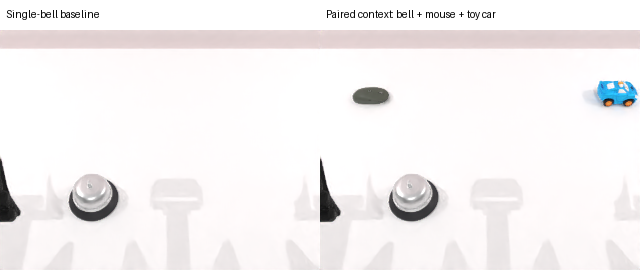
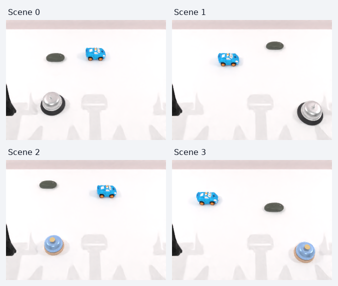

# Press / Lift Bell 实验

分支 `press_lift_bell`，从 master `8035546` 新建。旧瓶子实验已保存在
[`experiment/bottle-hold-place` 的 e7a7f7c](https://github.com/v-xchen-v/robotwin-if/commit/e7a7f7c)。

本任务在铃铛、鼠标、玩具车的共享场景中，用一个可移动铃铛比较 `Press down on the bell.` 和 `Lift the bell.`。去掉第二个目标、搬运和长时间悬停，
测试第一项完成的动作是否符合指令；历史实验结果不加入正式六任务成绩。

2026-10-23 已生成 [Press/Lift Bell v1 六任务清单](../seed-manifests/robotwin-if-press-lift-bell-v1-20-per-mode/README.md)，
用本任务替换旧 `bottle_verb`，其余五份 seeds 不变。铃铛固定为 20 blocks、40 回合（episode seeds `100000–100039`），
本次 expert 全通过，20 组初始 RGB/proprio 全部相同；两种铃铛模型 × 左右侧各 5 组。
bridge、seed contract 与六个 policy evaluator 的 `--seed-manifest` 入口已经接通；bash 入口 `scripts/eval.sh` 使用 `--manifest-dir`。
新清单无模型成绩，模型 eval 继续暂停；原始随机布局 pilot 和固定布局模型结果仍分别保留。

## 场景与原生依据

- Episode `2k` 为 press，`2k+1` 为 lift。完整初始化（包括相机、背景、机器人）均使用 scene seed `k`。
- 同一对共享动态 `050_bell`、0.05 kg 质量、碰撞网格和所有物理参数；mode 不参与场景生成。
- 铃铛置于桌面近处，左右交替；scene 0/1 使用 model 0，scene 2/3 使用 model 1。
- 默认 `--scene-layout context`：后侧随机摆放 `047_mouse/base0` 和 `057_toycar/base0`，均为动态 0.05 kg 原生资产。
  两者各自在 X ∈ [-0.30, 0.30] m、Y ∈ [0.04, 0.22] m 内采样，均可出现在左侧或右侧；
  水平中心距铃铛至少 22 cm，彼此至少 18 cm，避免重叠并避开近处的操作路径。
  使用由 scene seed 初始化的独立随机数发生器，拒绝不满足间距的候选，不消耗铃铛、相机等初始化的全局随机序列。
  `context_sampling_version=random-back-region-v1` 与每个 distractor 的稳定初始位置一同写入信号。
  没有秤、展台或目标垫。`--scene-layout bare` 保留单铃铛基线。
  布置区别于原生单铃铛 click 和“物体+展台”place 场景，目的是减少整场景模板识别；尚未做 bare/context 模型对照，不能声称已降低捷径，也不能保证消除铃铛的按压先验。
  陪衬物体带来少量目标识别要求，但只有一个铃铛，指令无需增加颜色、位置或手臂描述。
  主指标是同一画面下两条指令都成功，不能仅凭总成功率声称模型理解动词。
- 两句共享对象短语 `the bell`，只改变动作短语 `Press down on` / `Lift`，不指定手臂。
  `seen/unseen` 仅为 runner 兼容值，实际都返回当前 mode 对应的同一句固定指令。
- 原生 `click_bell` 支持按压，但使用静态铃铛；原生 `place_object_scale` / `place_object_stand` 的动态资产池
  包含铃铛，oracle 会先抓起它。它们的 instruction 是完整搬运任务，不能证明模型见过独立的 `Lift the bell.`。



图中左右为历史上相同 scene 0 的 bare / 固定位置 context 初始头部相机画面；机器人 proprio 完全相同。
`004` 和 `005` 的模型结果使用该固定布局；当前默认已改为上面的随机布局，不与历史模型结果合并。



当前随机布局的 scene 0–3；同一 scene 内的 Press/Lift 使用完全相同的初始画面。

## 判据

[物理监测器](../tasks/envs/_press_lift_bell.py) v3 在每个物理步后检查；保留原生 **4 ms** 仿真步长，推理等待不计时。
采样间隔由实际物理步长设置，不再以 20 ms 降采样；仅把阈值设为 2 ms 也无法在 4 ms 物理步之间获得新状态。
两个指令共用同一个、与 mode 无关的动作分类器。最大动作数均为 **250**。

- Lift：铃铛相对初始位置抬高至少 **3 cm**，与闭合夹爪实际接触、与桌面不接触，连续 **0.10 秒**。
  不要求搬运、特定朝向或长时间稳定。v3 与原生接触 helper 一样接受全部接触报告，包括零冲量的近邻接触。
- Press：夹爪预先闭合至少 **0.08 秒**，自闭合后且无接触的接近过程中累计下降至少 **5 mm** 后首次接触铃铛顶端区域；
  接触时铃铛由桌面支撑。随后闭合夹爪向上撤离至少 **2 cm**，与铃铛无抓持接触且桌面支撑持续 **0.06 秒**。
  从触碰到撤离期间铃铛上升不得超过 **1.5 cm**，水平位移不得超过 **3 cm**。
  顶端区域沿用原生 contact point 0 周围 XY 各 **2.5 cm**、Z **3 cm** 的接触代理。
- 按第一项完成的动作锁定结果。先 press 后 lift 只能通过 press 指令，反之亦然。
  正确动作可提前成功结束；先做错动作后，仍保留余下最多 250 动作的诊断轨迹，结果不会翻转。
  未完成任何动作是超时失败。单次接触不计按压，抓取时闭合夹爪也不直接计按压。

铃铛资产没有可动按钮或声音模拟，press 是“闭合夹爪从上方接触、随后撤离”的物理代理，不能称为按钮实际被按响。
这个实验测首个完成动作；不衡量最终保持状态，也不要求 lift 后仍保持到预算末尾。
每个版本的判据先在 oracle 上验证，再在该版本模型评测期间冻结。v3 是用户要求与原生接触检测对齐后的独立版本，
不覆写 v2 已完成结果。模型失败可能来自语言、动作执行或此代理的限制，需结合轨迹分析。

### 与原生 click_bell 的差异

原生 [`click_bell.check_success`](../third_party/robotwin/envs/click_bell.py) 检查铃铛所在侧的夹爪是否闭合，
随后从两只夹爪与 `050_bell` 的全部接触点中寻找 cp0 邻域内的点（XY 各 <2.5 cm、Z <3 cm）。
符合一次就锁定成功，不要求撤离；原生 oracle 的撤离动作并不是其 success 条件。

| 项目 | 原生 click_bell | 本实验 v3 Press |
|---|---|---|
| 铃铛物理 | 静态 | 与 Lift 共用动态 0.05 kg 铃铛 |
| 顶部区域 | cp0 的 XY/Z 容差 | 相同 |
| 接触点 | 全部物理接触报告，包括零冲量点 | 相同；v2 曾过滤冲量范数 ≤1e-7 的点 |
| 检查频率 | 每物理步 4 ms | 相同；v2 曾每 20 ms 采样 |
| 闭合与接近 | 对应侧夹爪当前闭合 | 接触的夹爪预闭合 80 ms，先下降 5 mm |
| 接触后行为 | 立即成功 | 撤离 2 cm，解除接触并满足支撑/位移限制 |
| 与 Lift 区分 | 不区分 | 按首次完成的动作锁定 |

两者不应当作相同难度的按压指标。资产没有独立可动按钮，原生指标也不检查按钮行程或发声。
原生 contact helper 不过滤零冲量点，因此“原生接触条件满足”和“产生实际接触冲量”需要分开报告。
仅凭本实验过滤后的 `touching=False`，不能推断原生条件没有满足。
v3 的每步信号另存 `native_click_success` 和 `native_click_first_time`：按原生对应侧闭合与任一夹爪顶部接触条件锁存，
用于区分“原生触碰已满足”与“完整 Press 尚未完成”；该诊断不改变首动作裁决，也不把 Lift 中的接触误算成 Press。

## 入口与产物

前提：仓库根目录，已安装 RoboTwin SAPIEN/cuRobo 环境及资产。输出目录必须不存在。

```bash
/home/xichen6/miniconda3/envs/RoboTwin/bin/python tools/press_lift_bell.py \
  --pairs 4 --sim-gpu 0 --output-dir outputs/policy-eval/press-lift-bell-oracle-new
```

这会运行完整配对 oracle，保存每回合图片、视频、物理信号、初始三路 RGB/proprio 数组与配对资格报告。
`--scene-seeds 0 3` 可选两个明确场景，始终展开完整 press/lift 对；不能用失败替换 seed。

启动现有模型服务后，可运行：

```bash
/home/xichen6/miniconda3/envs/RoboTwin/bin/python tools/press_lift_bell.py \
  --scene-seeds 0 3 --policy xvla --sim-gpu 0 \
  --output-dir outputs/policy-eval/press-lift-bell-xvla-new
```

`--policy` 支持 oracle、xvla、lingbot_va、lingbot_vla、vlact、dm05、hy_vla，端口沿用现有服务。
每次运行先通过完整配对 oracle，再逐回合复用现有 policy evaluator；推理前逐数组核对 RGB、统一编码 proprio、
指令及动作预算。共享 evaluator 仅补充 opt-in `policy_instruction` 接口，旧任务继续走原模板生成器。

| 产物 | 含义 |
|---|---|
| `run.json` / `resolved_config.json` | 参数、Git 身份、源码/配置哈希和实际配置 |
| `oracle/qualification.json` | 两边可行性和初始数组完全相同的证据 |
| `oracle/*_trace.jsonl` / `*_oracle.mp4` | oracle 物理轨迹（10 Hz 写盘）与视频 |
| `<policy>/*_result.json` / `*_actions.npz` / `*_[01].mp4` | 真实模型结果、动作和视频 |
| `<policy>/physics/*.jsonl` | v3 完整逐物理步（250 Hz）轨迹，含原生 click 诊断、先完成动作和接触信号；v2 历史文件为 50 Hz |
| `<policy>/*_scene_check.json` | 推理前观测、指令、预算核对 |
| `results.jsonl` / `summary.json` | 逐回合追加记录、press/lift 各自成功数及两边均成功数 |

产物位于 Git 忽略的本机 `outputs/`；文档中的路径不表示已上传运行产物。
所有已完成的 policy failure 保留；oracle / 服务错误与行为失败分开，禁止静默补抽场景。

## 验证记录

2026-10-23：10 项 classifier/runner 测试通过，9 项共享 setup 测试通过，六个 evaluator 的末尾裁决回归通过。
测试覆盖错误接触、闭合抓取、无抓持弹起、抬起后放回、时间中断、首动作不可翻转和固定 instruction 接线。

第一轮真实 oracle（`outputs/policy-eval/press-lift-bell-oracle-001`）在 model 0 的左右场景上 4/4 成功；
两组初始 RGB/proprio 完全相同。按压最高上升约 0.7 mm，lift 抬高约 10 cm。该轮尚无模型推理。

第二轮 `outputs/policy-eval/press-lift-bell-oracle-002` 覆盖两款铃铛、左右两侧，共 **8/8 成功**，
4 对初始三路 RGB/proprio 均完全一致，所有 press oracle 的首动作是 press，lift oracle 的首动作是 lift。
此阶段仅调整了 runner 的 policy 轨迹存储位置；任务和物理判据未修改。模型评测前将对最终 runner 再做配对资格检查。

随后的最终预检查（`press-lift-bell-six-models-2blocks-001/preflight`）中，seed 6 的固定深度 press oracle
把动态铃铛顶离桌面，该轮资格检查失败，**未启动任何模型推理**。此前 8/8 不能证明 oracle 每次都稳定。
已保留失败轨迹，并仅将 oracle 的固定 4.5 cm 下降改成先下降 2.5 cm、再以 2 mm 小步接近，检测到接触后撤离。
动态物理参数、instruction、250 动作预算和 v1 分类器全部不变。新版在 `press-lift-bell-six-models-2blocks-002` 验证。


小步 oracle 在 `002/preflight` 中未再出现顶飞，但 4 个 press 均未通过 v1 的“0.5 秒内下降 5 mm”速度条件；
4 个 lift 全部通过，仍未启动模型。此速度要求并非按压语义所需，v2 改为自闭合/上次接触后无接触接近阶段的
累计下降距离，同时保留预闭合、顶部接触、撤离、支撑和位移上限；短暂接触中断也不会清掉已经确认的按压候选。
新增慢速按压和接触抖动反例测试。最终评测改用 v2，前述 v1 历史结果不混入新分数。


v2 单铃铛验证（`003/preflight`）8/8 成功，4 对初始 RGB/proprio 全部相同。
随后根据用户对原生场景识别捷径的担忧，新增三物体 context 布置并保留 bare 基线；v2 判据、指令和铃铛位置不变。
六模型仍未启动，新的主实验使用 `press-lift-bell-six-models-2blocks-004`。

最终 context 场景的 `004/preflight` 已完成 **8/8 oracle 成功**（press 4/4、lift 4/4），覆盖两款铃铛与左右两侧。
4 对初始 RGB/proprio 完全一致；陪衬鼠标和玩具车未离开各自初始位置。11 项新任务测试通过。
本阶段只证明三物体场景中两种动作可行，尚无模型能力结论。

### v2 停止与原生接触诊断

`004` 在用户要求对齐原生接触检测后停止，完成 **12/24** 回合，三模型结果保留如下；后三个模型未完成评测。
其 `frozen-source/` 保存全部受哈希约束的旧源码，`stopped-for-criterion-revision.json` 记录停止原因和当时状态。
停止后，12 个已完成回合的原始轨迹均使用冻结的 v2 分类器重放一致，12 段视频均完整解码且帧数等于动作数加一；
验证记录为 `004/validation-stopped.json`。

| 模型 | v2 Press | v2 Lift | 两边均成功 |
|---|---:|---:|---:|
| X-VLA | 1/2 | 0/2 | 0/2 |
| LingBot-VA | 0/2 | 1/2 | 0/2 |
| LingBot-VLA | 0/2 | 0/2 | 0/2 |

LingBot-VA 的两个 Press 回合在原始 50 Hz 日志中均无通过冲量过滤的接触。为检查是否与原生不同，
使用保存的 250 个 EE 动作回放，并逐物理步调用未修改的原生 `click_bell.check_success`；不调用模型。
诊断结果见[可追溯摘要](assets/press-lift-bell-native-contact-audit.json)，详细产物在
`004/native-click-geometry-audit/`。

| Press seed | 回放中原生条件 | 冲量 >1e-7 的接触 | 报告的最小接触间隙 | 仅去掉冲量过滤后的 v2 分类器 |
|---|---|---:|---:|---|
| 0 | 满足 | 0 | 1.22 mm | Press 成功 |
| 6 | 满足 | 0 | 4.03 mm | Press 成功 |

所有报告点的冲量均为零，原生会接受碰撞系统提前报告的近邻接触。两段回放仍按 v2 的 20 ms 分类、
保留原有下降/撤离等条件，仅去掉夹爪接触的冲量过滤，即可完成 Press，因此这两例的差异并非仅是采样频率造成。
初始 RGB/proprio/关节状态完全一致，但运动规划器的内部步数不同；动作边界位置最大差分别为 0.81 mm、0.66 mm。
这是保存动作的回放诊断，不是逐物理步精确复现，也不用于把旧模型失败记录重标为成功。

### v3 对齐

按用户要求，v3 去掉冲量门槛，并直接在每个原生 4 ms 物理步后检查；不更改仿真步长和动作时间尺度。
额外输出原生 click 条件的锁存结果。其他动作分类条件保持原定义，因此完整 Press 仍比原生瞬间触碰要求更多。
新增零/微小冲量接触和单个 4 ms 接触的回归覆盖；13 项本任务测试、3 项 IF evaluator 测试及六模型末尾裁决测试通过。
新评测目录为 `outputs/policy-eval/press-lift-bell-six-models-2blocks-005`，先做八回合 oracle 资格检查，再重新运行模型。
v3 的 `005/preflight` 已 **8/8 通过**，Press 4/4、Lift 4/4，四对初始观测完全相同；八个回合的初始 RGB/proprio
也逐数组等于 v2 的对应场景，确认这次只改变接触判据和检查频率，没有改变初始场景。

### 暂停评测后：先随机化 distractor

用户要求暂停模型 eval 后，`005` 在 **6/24** 个完整回合处停止：LingBot-VA Press 2/2、Lift 1/2、双成功 1/2；
X-VLA 首个场景两回合未通过完整动作判据，第二个场景的 Press 回合中途停止，不计行为失败。
任务与模型进程已停止，`005/paused.json` 记录恢复边界，`005/frozen-source/` 保存固定布局源码。
X-VLA seed 0 已满足原生 click，但相对首次接触的最大撤离为 1.36 cm，未满足完整 Press 的 2 cm 条件。

接下来按用户指定顺序先处理位置随机化：保留两个 distractor 的身份、质量和姿态，改变其采样位置；
每个 Press/Lift 对仍使用同一个 scene seed。15 项本任务测试通过，覆盖 256 个种子的区域、间距、左右次序变化、
可复现性和全局随机状态不变。场景可执行性使用独立的 `press-lift-bell-random-context-oracle-001` 检查。
此阶段模型 eval 保持暂停，instruction 留待下一步处理。
随机布局的 oracle 已 **8/8 成功**，四对初始三路 RGB/proprio 完全相同；与固定布局相比，铃铛初始位置和机器人
proprio 也逐数组相等。实际初始化满足采样间距，oracle 轨迹中 distractor 未发生位移。详细检查见
`press-lift-bell-random-context-oracle-001/layout-validation.json`。

### Instruction：保留相同对象，调整动作短语

用户选择保留 verb-something 对照后，当时固定指令改为以下两句（Lift 已在后续对照后改回，见下节）：

| 内部 mode | 模型实际收到的 instruction |
|---|---|
| `press` | `Press down on the bell.` |
| `lift` | `Pick up the bell.` |

共同对象短语均为 `the bell`，只替换动作短语 `Press down on` / `Pick up`。这是动作短语对照，
不再称为只替换一个单词；不增加颜色、左右手、放置目标或操作数值。

参考依据来自原生可进入指令生成的模板：

- [`click_bell`](../third_party/robotwin/description/task_instruction/click_bell.json) 中有
  `Press down {A}'s top center gently.` 和 `Press {A}'s top center on the table.`。
  当前句借鉴向下按压的表达，并将对象统一为整只铃铛；没有只为 Press 增加 `top center` 这一部位提示。
- [`place_object_stand`](../third_party/robotwin/description/task_instruction/place_object_stand.json) 中有
  `Pick up {A} and set it on {B}.`；[`place_object_scale`](../third_party/robotwin/description/task_instruction/place_object_scale.json)
  中也有 `Pick up {B} and set it on {A}`。两任务的动态物体池都包含 `050_bell`，当前只提取抓起子动作，去掉搬运目标。
- 原生 `lift_pot` 同时使用 `Lift`、`Grab … and lift …`、`Pick up` 等表达，但属于双臂操作锅，不能直接复制其手臂要求。

这些是从原生模板改写/截取的固定指令，不是声称原生数据集中存在完全相同的独立句子，也不能证明模型见过这些具体文本。
实际运行的 [`filter_instructions`](../third_party/robotwin/description/utils/generate_episode_instructions.py)
要求物体占位符与 episode metadata 匹配：`click_bell` 的 50 条 seen 中只有 31 条、10 条 unseen 中只有 7 条符合当前
`{A}`/`{a}` metadata；部分纯字面 bell 句子不会进入该生成链路。因此引用时核对了过滤后的模板。

实际模型文本由 `INSTRUCTIONS → env.policy_instruction → setup_episode → policy adapter` 传递，
已同步修改运行时常量与任务 JSON；只改 JSON 不会改变本实验实际下发的固定文本。15 项本任务测试通过，包含 instruction 接线验证。
本次只调整语言，不改变随机布局、物理参数或动作分类器；完整 Press 的额外撤离要求仍存在。
此前所有模型结果及 `press-lift-bell-random-context-oracle-001` 均使用旧句 `Press the bell.` / `Lift the bell.`。
模型 eval 仍暂停，尚未用新句进行推理，不能据此宣称性能提升。

### 2026-10-26：Lift 改回旧 instruction

当前运行时指令为 `Press down on the bell.` / `Lift the bell.`；`seen` 和 `unseen` 均使用这组固定文本。
只修改 Lift 动作短语，对象仍为 `the bell`。场景随机化、seed、250-action 上限与成功判据均保持不变。

依据是 2026-10-23 的 LingBot-VA 指令对照：预先选定当前 manifest 的四个 Lift seeds
`100001, 100003, 100005, 100007`，覆盖两种铃铛模型 × 左右侧。
相同 checkpoint、推理参数、判据和逐数组一致的初始 RGB/机器人状态下，
`Lift the bell.` 为 **1/4** 成功，已有的 `Pick up the bell.` 为 **0/4**。
成功 seed `100007` 在第 78 步抬高约 3.42 cm，通过原有 Lift 判据。
这是小样本诊断，尚不能说明表现稳定；推理设置固定随机种子，但未强制使用确定性 kernels。
完整记录位于 `outputs/policy-eval/lingbot-va-bell-lift-old-instruction-4seeds-001/README.md`。

按用户要求，原 `robotwin-if-press-lift-bell-v1-20-per-mode` 包已直接覆盖 Lift 配置，名称与 seeds 不变。
`suite.yml` 的 `instruction_override` 记录原指令及覆盖后的源码哈希；`qualification/instruction-override/`
保存更新后的两个语言源文件。原始 expert 日志、生成源码快照和已完成的正式评测仍保留实测文本。
包校验同时验证当前指令、原始资格证据与只修改语言的源码差异；本次未重新筛选 seeds 或恢复评测。
源码已改变，暂停运行不能直接续跑并混合两种 instruction 的成绩。
新评测通过当前任务实现接收 `Lift the bell.`，需使用独立输出目录并记录实际 instruction 与源码。
