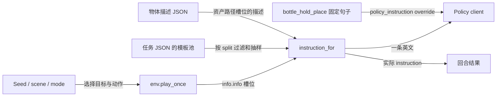

# Instruction 构造：模板、场景槽位与模型输入

核对日期：2026-10-23。
范围：正式六个 IF 任务的模板、槽位、共享评测入口及已有逐回合指令；补充原生 RoboTwin 的代表性任务、仓库保留的实验任务，以及 `bottle_hold_place`。
报告归属：robotwin-if。首次调研仅新增此说明；后续同日同步了 hold/place 的指令文字更新。

版本：父仓库 `https://github.com/v-xchen-v/robotwin-if.git`，分支 `experiment/bottle-hold-place`，HEAD `867ddc71e32efb6867da5b0e5a387bd1b1057f13`。
父仓库 gitlink 与 RoboTwin 实际 HEAD 均为 `b82ffb81d291d14c24be444bb7b6f81719481e0f`。
RoboTwin 已有未提交修改涉及 `description/utils/{clear_task_seen_unseen,generate_episode_instructions,generate_task_description}.py` 和 `task_config/demo_clean.yml`；本报告描述实际工作区源码，不将其等同于原始上游 commit。
实际 episode generator 的 SHA-256 为 `146841d4b666b811d6c3f0ef0d20b578c5fd36ee80a5b733a813e50f82e571e4`；离线 task generator 为 `e4cc350f7dfd06ff618f8aa10ada8938f0979e07d820fcbad523927765035fe0`。

## 一句话理解

环境根据场景和 mode 填写 `info["info"]`，评测入口按 seed 从任务 JSON 抽取匹配模板、替换物体和动作槽位，得到一条英文指令交给 policy，并保存到回合结果。

## 入口与输入

| 入口 | 输入及约束 | 输出 / 调用方 | 依据 |
|---|---|---|---|
| 各任务 `play_once()` | episode seed、场景与 mode；`info["info"]` 只放占位符键 | 返回 oracle info，供共享评测器保存和生成语言 | [任务目录](../../tasks/envs/) |
| `setup_episode()` | env、config、seed、语言 split；先完成该 seed 的 oracle qualification，再重新初始化 policy 场景 | 返回 `(instruction, obs)`，设置 `env.instruction` 与结果中的 `instruction` | [共享评测器](../../policies/evaluation.py) |
| `instruction_for()` | task、oracle info、split、seed；IF 默认 `unseen`，拒绝 `task-name` | 生成一条指令；供六个 policy 的共享 setup 使用 | [eval.py](../../policies/xvla/eval.py)，`select_seeds` / `instruction_for` |
| `generate_episode_descriptions()` | 任务名、槽位字典列表、`max_descriptions` | 返回每个 episode 的 `seen` / `unseen` 字符串列表；评测时上限为 1 | [episode generator](../../third_party/robotwin/description/utils/generate_episode_instructions.py) |
| 离线 task generator | `full_description`、`schema`、`preference`，以及模型生成接口 | 向 task JSON 追加模板；本次未执行该入口 | [task generator](../../third_party/robotwin/description/utils/generate_task_description.py) |

| 输入层 | 来源 | 实际含义 / 优先级 |
|---|---|---|
| 句式 | `tasks/task_instruction/<task>.json` 的 `seen`、`unseen` | 正式六任务的运行时 JSON 与本地源文件逐字节一致；通过 [bridge](../../scripts/_task_bridge.py) 暴露给 RoboTwin |
| 字面槽位 | 环境给出 `the block`、`red block`、`to the left of` 等 | 原样替换；大写槽位不会自动加冠词 |
| 手臂槽位 | 单个小写字母，如 `{a}: left` | 转为 `the left arm`；任务模板可能省略所有手臂槽位 |
| 资产引用槽位 | 如 `{A}: 001_bottle/base13` | 读取 `description/objects_description/001_bottle/base13.json`，抽取对应 split 的描述并加 `the`；unseen 物体描述池为空时回退 seen |
| 随机种子 | `instruction_for()` | Arm 的 `jitter-v2` / `cube-v3` 使用 `seed // 2`，其余任务使用 episode seed；调用后恢复 Python RNG 状态 |
| 实验任务 override | `env.policy_instruction(split)` | 存在时优先于通用模板生成；`bottle_hold_place` 直接返回固定句子 |

`full_description`、`schema`、`preference` 是模板编写 / 离线生成的说明字段，运行时不会把它们附加到 policy 指令。
其中的字数、语义要求也不会由 episode generator 自动检查；实际行为由字符串模板、槽位和专门测试决定。

## 输出与副作用

| 输出 | 产生条件 | 下游 / 状态 |
|---|---|---|
| 一条英文 `instruction` | oracle 通过、policy 场景重置后 | 设置到 env，并由 policy client 接收；X-VLA 使用请求字段 `language_instruction`，见 [client.py](../../policies/xvla/client.py) |
| `_oracle.json` 和回合记录 | 共享 evaluator 运行时 | 保存槽位、实际指令及结果；已有汇总见 [episodes.csv](../../result/robotwin-if-arm-only-v2-20blocks/episodes.csv) |
| `data/<task>/<setting>/instructions/episodeN.json` | 单独调用 RoboTwin 离线 episode 生成 CLI | 保存 `seen` / `unseen` 列表；本次未生成；该写入函数覆盖同名文件 |
| task JSON 的模板池 | 单独执行离线 task generator | 生成内容追加到 `seen` / `unseen`；本次未调用模型、未修改模板 |
| 本报告 | 本次源码与记录调研 | 新增文档；下面的本次验证没有启动仿真或 policy 推理 |

## 数据流



过滤要求模板占位符与 episode 参数匹配；允许省略全部手臂参数，但不会任意忽略非手臂参数。
因此不能把 `mode`、诊断统计等附加到 `info["info"]`；它们应保留在外层 info。
过滤前会打乱模板列表，评测设置 `max_descriptions=1`，取所选 split 的第一条。
评测过程使用预先写好的模板池；本次所读的共享入口没有在线调用语言模型编写新 instruction。

## 正式六任务如何构造

以下例句由真实模板和槽位构成，用于说明结构；实际评测可能抽到其他句式。数量按 JSON 列表项计数。

| 任务 | 可变槽位与来源 | 构造例子 | seen / unseen 模板数 |
|---|---|---|---|
| [bottle_verb](../../tasks/task_instruction/bottle_verb.json) | `{V}` 为 `pick up` / `grab` / `lift` 或 `shake`；`{A}` 引用瓶子资产描述；可选 `{a}` | `{V} {A} with {a}.` | 40 / 10 |
| [pick_diverse_object](../../tasks/task_instruction/pick_diverse_object.json) | `{A}` 为字面的 `the <noun>`；可选 `{a}` | `Pick up the bread carefully using the left arm` | 12 / 4 |
| [attribute_select](../../tasks/task_instruction/attribute_select.json) | `{ADJ}` 是完整目标短语，没有 arm slot | `Pick up the red block.` / `Pick up the blue block.` | 10 / 2 |
| [arm_select](../../tasks/task_instruction/arm_select.json) | `{A}=the block`；每条都必须有 `{a}` | `Use the left arm to retrieve the block.` / `Use the right arm to retrieve the block.` | 30 / 10 |
| [stack_sequence](../../tasks/task_instruction/stack_sequence.json) | `{A}/{B}/{C}` 分别代表底 / 中 / 顶位置，填入对应颜色；现有模板不使用 arm slots | `Stack the blocks bottom to top: red block, green block, blue block.` | 28 / 10 |
| [place_relative](../../tasks/task_instruction/place_relative.json) | `{A}/{B}` 是 mover / reference 的 `the <color> <noun>`；`{D}` 为关系；可选 `{a}` | `Place the black remotecontrol to the left of the red tea-box` | 24 / 6 |

具体槽位生产见 [Bottle](../../tasks/envs/bottle_verb.py) 的 `_verb` / `play_once`、[Noun](../../tasks/envs/pick_diverse_object.py) 的 `play_once`、[Attribute](../../tasks/envs/attribute_select.py) 的 `AXIS_PHRASES`、[Arm](../../tasks/envs/arm_select.py) 的 `play_once`、[Sequence](../../tasks/envs/stack_sequence.py) 的 `play_once`、[Spatial](../../tasks/envs/place_relative.py) 的 `PHRASES` / `play_once`。

Attribute 的完整短语为：`red/blue block`、`block with a cat/dog on it`、`cube/long bar`、`big/small block`。
Spatial 当前只运行 `to the left of`、`to the right of`、`on top of`；JSON 的说明字段仍提到旧版 front/back，运行范围应以环境和正式 inventory 为准。

Noun 的对象描述采用名词字面值，避免资产描述池额外附加颜色、形状；但部分句式仍指定手臂。
其 mode 的 `seen/unseen` 指物体 familiarity，与 JSON 模板 split 是两个独立维度。两个物体 familiarity mode 使用不同场景，不能把它们解释为同一画面仅换目标名词的对照。

## 原生任务及其他保留实验的构造

原生模板同样使用任务句式和资产描述。代表性模板：

| 原生任务 | 模板原文 | 对本次设计的含义 |
|---|---|---|
| [shake_bottle](../../third_party/robotwin/description/task_instruction/shake_bottle.json) | `Pick up {A} and shake it.` | 原生摇瓶指令经常同时出现 pick up 和 shake |
| [adjust_bottle](../../third_party/robotwin/description/task_instruction/adjust_bottle.json) | `Grab {A} from the table and hold it head-up.` | 已有抓起并保持瓶口朝上的指令语义；Noun 模板说明记录了复用其去掉方向约束的子集 |
| [move_pillbottle_pad](../../third_party/robotwin/description/task_instruction/move_pillbottle_pad.json) | `Pick {A} and place it on the pad` | 已有“拿瓶状物放到垫上”的任务语义；与新 place 分支接近 |
| [stack_blocks_three](../../third_party/robotwin/description/task_instruction/stack_blocks_three.json) | `Stack {C} over {B} and {B} over {A} after moving all blocks to the center.` | 原生任务说明固定红底、绿中、蓝顶；IF Sequence 把颜色映射到六种顺序 |

这些源码证明仓库存在相近任务和措辞；没有逐模型检查实际训练样本，不能据此量化每个 checkpoint 的训练覆盖。

其他保留的 env / JSON 不在[正式六任务 inventory](../../eval_cfg/if_tasks.yml)内，当前也未安装到本机 RoboTwin 的任务描述目录：

| 保留任务 | instruction 构造 |
|---|---|
| [laptop_verb](../../tasks/task_instruction/laptop_verb.json) | `{V}` 注入 open / close 动词，`{A}` 指 laptop，共用句式池 |
| [operate_stapler](../../tasks/task_instruction/operate_stapler.json) | press 模板只有 stapler；move 模板多一个 mat 的 `{B}`，按占位符集合路由 |
| [operate_tabletop](../../tasks/task_instruction/operate_tabletop.json) | bell / stapler / picked object 分别用 `{A}` / `{B}` / `{C}`，每条只含其中一个，按槽位路由到对应任务 |
| [operate_mic_drawer](../../tasks/task_instruction/operate_mic_drawer.json) | 每条明确哪只手开抽屉，另一只手放麦克风；复用原生 cabinet 的带手臂句式 |

这几个任务的说明来自 JSON / 源码；本次没有验证它们当前的仿真可执行性。

## 现有构造对公平性的影响

### 配对场景与配对措辞需要分别控制

Arm `cube-v3` 使用同一个 pair seed 抽句式，配对中仅替换 left/right。其他正式任务通常按 episode seed 抽样，句式可能同时改变。
Bottle 还随机抽取物体描述。已有 X-VLA 记录中，seeds `100002/100003` 分别为：

```text
pick up the curvy yellow plastic bottle gently.
shake the smooth bottle with blue text gently.
```

这对记录的目标动词和物体描述都变化。上述文本来自已归档 [episodes.csv](../../result/robotwin-if-arm-only-v2-20blocks/episodes.csv)，没有重跑模型。
Sequence 的同组记录也会改变句式，例如从 `Put ... down, ... on ..., ... on ...` 换成 `Stack ... over ... and ... over ...`。
因此“设计只研究某个轴”与“传给模型的两个字符串只在该轴上变化”需要分别核对。

### seen / unseen 不等于动作在训练中见过 / 没见过

模板 JSON 的 split 表示语言池；资产描述也有自己的 split；Noun 另外还有物体 familiarity 分组。
本次静态比较发现，旧 Bottle 的 10 条 unseen 模板有 **5 条与 seen 完全相同**。其他五个正式任务的模板池没有精确字符串交集。
无交集仅说明字符串不同，不保证动作、组合语义或近义句没进入模型训练。

### 指令应清楚表达判据所要求的行为

旧 Bottle 的 `pick up` / `grab` / `lift` 本身没有明确持续稳定保持，模板还可能包含 `for a moment` 等修饰；稳定和摇动约束来自 checker。
当前 hold/place 的 fixed instruction 明确写出先 `Pick up`，随后 `hold it steady above` 或 `place it on ... then release it`，有助于减少这个语义缺口。
Noun 的 `correct arm`、原生模板的额外副词等也值得在后续最小对比实验中单独控制，不宜仅凭槽位测试通过就认定所有句式等价。

## 对 bottle_hold_place 的建议

当前实际指令来自 [INSTRUCTIONS](../../tasks/envs/_bottle_hold_place.py)，由 [policy_instruction](../../tasks/envs/bottle_hold_place.py) 直接返回：

```text
Pick up the bottle and hold it steady above the blue pad.
Pick up the bottle and place it on the blue pad, then release it.
```

JSON 的 `seen/unseen` 都是 `{I}`；当前 policy 入口使用 override，两个 split 都得到同一句固定指令。
共享 `Pick up the bottle and` 前缀，固定物体称谓 `the bottle` 与目标称谓 `the blue pad`，不再抽取资产形容词，也不指定手臂或绝对朝向。

建议先保持这对固定指令，评测完整配对；之后再增加数量相同、逐对对应的 paraphrase，以 block 为单位选择句式，同时记录模板 ID。
这样能分别研究动作区分和措辞鲁棒性。
原生 `adjust_bottle` 与 `move_pillbottle_pad` 表明两侧都有相近语义，本实验更适合描述为“对同一场景给出两个明确终态要求”。
若要声称“两条完整任务均未在训练中出现”，仍需独立核对任务组合和各 checkpoint 的训练清单；当前代码与 oracle 通过率无法证明这一点。

## 证据与本次验证

| 契约 | 证据 | 本次结果与边界 |
|---|---|---|
| Attribute 完整指称、无手臂、槽位路由 | [test_instruction_routing.py](../../tests/attribute_select/test_instruction_routing.py) | 实际执行，8/8 检查通过 |
| Noun 字面名词、split 无重叠、槽位路由 | [test_instructions.py](../../tests/pick_diverse_object/test_instructions.py) | 实际执行，11/11 检查通过 |
| Sequence 三个顺序槽位及颜色替换 | [test_instruction_routing.py](../../tests/stack_sequence/test_instruction_routing.py) | 实际执行，6/6 检查通过 |
| Spatial 统一模板池、关系修饰 reference、无重叠 | [test_instructions.py](../../tests/place_relative/test_instructions.py) | 实际执行，17/17 检查通过 |
| Arm 配对只变手臂并恢复 RNG | [test_scene_variation.py](../../tests/arm_select/test_scene_variation.py) 的 `test_paired_language_only_changes_arm_and_restores_rng` | 单独执行该 unittest，通过；覆盖 jitter-v2 / cube-v3 的各 12 对，并核对旧版行为 |
| 正式任务运行时 JSON 与源文件一致 | 逐文件字节比较 | 六个正式任务全部一致；实验 hold/place 使用独立 override |
| 已发给模型的真实字符串 | 归档 `episodes.csv` | 读取已有证据；不等于本次执行了 policy |
| 语义难度、训练集熟悉度 | 当前源码不能充分确定 | 待核对训练清单并做模型配对评测；上述 CPU 检查不验证这些性质 |

本次共执行 42 项脚本检查和 1 个 Arm unittest；没有启动仿真、模型服务或离线文本生成。

最小验证示例（仓库根目录，已安装 `RoboTwin` Conda 环境；本次已执行，预期打印 17/17 passed）：

```bash
conda run -n RoboTwin python tests/place_relative/test_instructions.py
```

## 更新与理解纠正

- 2026-10-23：首次整理。区分场景配对与措辞配对、模板 split 与物体 / 动作 familiarity；记录 Bottle split 的重复模板、Spatial 说明字段残留五模式，以及新 hold/place 与原生任务的语义相近之处。
- 2026-10-23：用户请求构造 hold/place 指令后，两条固定指令统一补充 `Pick up the bottle and` 前缀。上文已同步当前文字；已有 oracle-001–004 仍保留更新前的原始指令，见[实验记录](../bottle-hold-place-experiment.md)。
