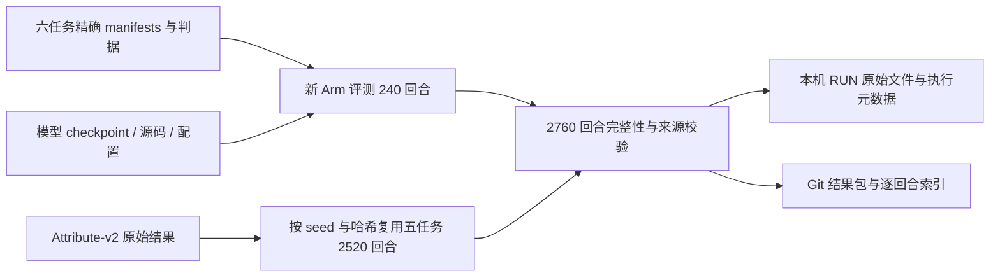

# 开源模型正式评测：代码、任务、seed 与结果溯源

> 本文记录 Arm-only-v2（Bottle）的历史评测。旧清单与结果链接固定到备份提交；文中的旧版命令请在[备份分支](https://github.com/v-xchen-v/robotwin-if/tree/master-261027-staper-v1)执行。当前清单见 [Stapler v1](../../seed-manifests/robotwin-if-press-lift-stapler-v1-20-per-mode/README.md)。

核对日期：2026-10-22。范围：当前 `master` 发布的六模型 **Arm-only-v2 / 20 blocks** 结果。
核对时仓库 HEAD 为 `93d7271fc1ddda18822c30a2ee043cf946c3624f`。
本文是已有评测的来源整理；本次没有启动模型评测。
完整 SHA、每任务来源目录及回合数见同目录的[机器可读来源摘要](open-source-eval-source-lineage.json)。

## 当前结果是什么

当前正式结果是 **6 个模型 × 6 个任务，每模型 460 回合，总计 2760 回合、720 blocks**。
原始运行于 **2026-09-18 05:26:32 UTC** 完成，记录 1097 次成功、1663 次 policy failure。
本版重新评测 Arm 的 240 回合，其他五任务的 2520 回合从 Attribute-v2 结果逐字节复用，包含成功和失败。
因此，`Arm-only-v2` 是整套结果的发布名，各任务有自己的场景与成功判据版本。

| 查什么 | 当前入口 |
| --- | --- |
| 六模型成绩 | [results.md](https://github.com/v-xchen-v/robotwin-if/blob/ac582a75267126c7a8fe17c220475d517b73882b/result/robotwin-if-arm-only-v2-20blocks/results.md)、[results.html](https://github.com/v-xchen-v/robotwin-if/blob/ac582a75267126c7a8fe17c220475d517b73882b/result/robotwin-if-arm-only-v2-20blocks/results.html) |
| 逐回合成绩与原文件哈希 | [episodes.csv](https://github.com/v-xchen-v/robotwin-if/blob/ac582a75267126c7a8fe17c220475d517b73882b/result/robotwin-if-arm-only-v2-20blocks/episodes.csv) |
| 精确 seeds 与任务配置 | [seed release](https://github.com/v-xchen-v/robotwin-if/blob/ac582a75267126c7a8fe17c220475d517b73882b/seed-manifests/robotwin-if-arm-only-v2-20-per-mode/README.md)、[suite.yml](https://github.com/v-xchen-v/robotwin-if/blob/ac582a75267126c7a8fe17c220475d517b73882b/seed-manifests/robotwin-if-arm-only-v2-20-per-mode/suite.yml) |
| 模型权重身份 | [checkpoints.json](https://github.com/v-xchen-v/robotwin-if/blob/ac582a75267126c7a8fe17c220475d517b73882b/result/robotwin-if-arm-only-v2-20blocks/checkpoints.json) |
| 运行计划、来源、完成校验 | [plan.json](https://github.com/v-xchen-v/robotwin-if/blob/ac582a75267126c7a8fe17c220475d517b73882b/result/robotwin-if-arm-only-v2-20blocks/plan.json)、[provenance.json](https://github.com/v-xchen-v/robotwin-if/blob/ac582a75267126c7a8fe17c220475d517b73882b/result/robotwin-if-arm-only-v2-20blocks/provenance.json)、[validation.json](https://github.com/v-xchen-v/robotwin-if/blob/ac582a75267126c7a8fe17c220475d517b73882b/result/robotwin-if-arm-only-v2-20blocks/validation.json) |

当前 `vlact` 成绩使用 **VLAct All（Clean+Random，100K）**。
另一个 Clean 50K checkpoint 的评测停在 308/460，未纳入这里的六模型成绩。
其部分产物保留在 `/Data/robotwin-if/evaluations/robotwin-if-vlact-clean-20blocks-20260924-parallel/`，
延期清理说明在该目录的 `support/deferred-cleanup-20261022T025451Z/README.md`。
六模型中 X-VLA 使用 clean 微调 checkpoint，其余五个使用 clean + randomized 微调 checkpoint。
所有模型均使用 `instruction_type=unseen`；Noun 的 `seen/unseen` mode 表示物体类别熟悉度，是另一个维度。
Overall 对六个 Task Avg. 等权平均，每个 Task Avg. 再对 modes 等权平均；不能用成功数除以 460 替代 Overall。

## Code version：发布版本与实际执行版本

| 版本层次 | 固定标识 | 含义 |
| --- | --- | --- |
| 本次核对的公开代码 | `93d7271fc1ddda18822c30a2ee043cf946c3624f` | 当前 `master` 的代码、文档及结果入口 |
| 当前任务套件首次提交 | `3bbaead50e56e8f77e78df5d6bbe77e3b253f1ba` | 2026-09-18 发布 Arm-only-v2 taskset |
| 当前结果首次提交 | `ce17465e13a4277f48f9c04d6e3b37d47464aa3d` | 2026-09-18 发布已校验的 2760 回合结果 |
| 历史证据固定点 | `2670a13f53f6e3f1cc2e6f0fdae558782cb88d7d` | 完整 verifier 从 Git 历史恢复旧清单、资格证据与复用记录 |
| 实际运行的 RoboTwin | `b82ffb81d291d14c24be444bb7b6f81719481e0f` + 本地修改 | 2760 回合追溯到的原始运行元数据均记录此版本 |

**不能把这些成绩标成“全部由某一个干净 commit 跑出”。**
沿每回合的 `_provenance.json.source_directory` 递归追溯，本次找到 95 份实际执行的 `run.json`；
对应 2760 回合的 RoboTwin-IF 工作树都记录了未提交修改。
下表的 commit 是原始执行批次记录的 HEAD，括号是六模型合计回合数；完整 SHA 与源目录在[来源摘要](open-source-eval-source-lineage.json)的 `tasks[].original_execution_sources` 中。

| 任务 | 原始执行的 RoboTwin-IF commit（回合数） |
| --- | --- |
| Bottle | `bf25bc3`（40）、`72d7c36`（200） |
| Noun | `d7d06f5`（40）、`937c243`（40）、`c25f5cf`（160） |
| Attribute | `f845f65`（960） |
| Arm | `f845f65`（127）、`23da900`（113） |
| Sequence | `d7d06f5`（120）、`937c243`（120）、`c25f5cf`（480） |
| Spatial | `d7d06f5`（30）、`feaae02`（11）、`937c243`（79）、`c25f5cf`（240） |

实际代码应由 **执行批次的 commit + dirty 状态/补丁 + task/config/source SHA256 + 冻结源码** 联合定位。
Arm-only-v2 原始运行目录中的 `support/` 保存：

```text
source-hashes.json             # 1060 个源码文件的 SHA256
source-snapshot/               # 发布时冻结的源码
robotwin-if-source.patch       # RoboTwin-IF 未提交修改
robotwin-source.patch          # RoboTwin 未提交修改
parallel-source-hashes.json
postprocessing-hashes.json
remote-msrait03.json
hy-vla-sharding/               # 远程推理、分片与部署记录
```

冻结源码清单的 SHA256 为 `b2a0edbbdf5675ec9adf6359ebc961c0be1f93e8008c5274c41c787cb309b8bb`。
本次比对当前工作区，1060 项中 1059 项完全一致；唯一差异是 `tools/run_formal_policy_suite.py`
把默认 release 从 Attribute-v2 改成 Arm-only-v2，完整 verifier 检查了这项精确差异。
六个当前任务文件、相关 helper、共享评测代码和任务配置均与该发布快照一致。
这份快照描述 Arm-only-v2 发布时的源码；更早批次仍需使用各自的执行元数据，尤其是下文的 Spatial 来源。

RoboTwin 的历史 tracked 修改涉及三个 description 工具的 UTF-8 读写，以及 `task_config/demo_clean.yml`
中的 `episode_num: 50 → 2`。正式评测回合数由 manifest 指定，不能从该配置项推断为两回合。
另有一个已存在的版本差异：[README](../../README.md) 和 [bridge 锁定常量](../../scripts/_task_bridge.py)
声明 `0aeea2d669c0f8516f4d5785f0aa33ba812c14b4`，实际 gitlink 和运行记录则为上表的 `b82ffb8…`。
因此，直接按 README 的 bridge 版本安装，不能据此声称与这批历史运行源码完全一致。

## Task version 与 manifest seeds

统一 manifest 目录为 `seed-manifests/robotwin-if-arm-only-v2-20-per-mode/`。
各模型使用同一份任务 seed 列表，每任务 **20 个完整 balanced blocks，每个 mode 20 个 seeds**。
除 Arm 使用 `demo_clean_arm_select_v3` 外，其余任务配置均为 `demo_clean`。

| 任务 / 代码 | 场景或 checker 版本 | modes | 回合/模型 | action 上限 | 精确 seed 文件；最小–最大 seed |
| --- | --- | --- | ---: | ---: | --- |
| [Bottle / bottle_verb](../../tasks/envs/bottle_verb.py) | `relative-lift-hold-v6-terminal` | pick、shake | 40 | 700 | [bottle_verb.json](https://github.com/v-xchen-v/robotwin-if/blob/ac582a75267126c7a8fe17c220475d517b73882b/seed-manifests/robotwin-if-arm-only-v2-20-per-mode/bottle_verb.json)；100002–100057 |
| [Noun / pick_diverse_object](../../tasks/envs/pick_diverse_object.py) | 无独立 checker 版本名，固定 task SHA256 | seen、unseen | 40 | 400 | [pick_diverse_object.json](https://github.com/v-xchen-v/robotwin-if/blob/ac582a75267126c7a8fe17c220475d517b73882b/seed-manifests/robotwin-if-arm-only-v2-20-per-mode/pick_diverse_object.json)；100002–100067 |
| [Attribute / attribute_select](../../tasks/envs/attribute_select.py) | `target-only-lift-v2` | color、decal、shape、size 各两种 | 160 | 400 | [attribute_select.json](https://github.com/v-xchen-v/robotwin-if/blob/ac582a75267126c7a8fe17c220475d517b73882b/seed-manifests/robotwin-if-arm-only-v2-20-per-mode/attribute_select.json)；100000–100175 |
| [Arm / arm_select](../../tasks/envs/arm_select.py) | 5 cm cube-v3 + `target-arm-only-lift-v2` | left、right | 40 | 400 | [arm_select.json](https://github.com/v-xchen-v/robotwin-if/blob/ac582a75267126c7a8fe17c220475d517b73882b/seed-manifests/robotwin-if-arm-only-v2-20-per-mode/arm_select.json)；500000–500039 |
| [Sequence / stack_sequence](../../tasks/envs/stack_sequence.py) | 无独立 checker 版本名，固定 task SHA256 | RGB 六种排列 | 120 | 1200 | [stack_sequence.json](https://github.com/v-xchen-v/robotwin-if/blob/ac582a75267126c7a8fe17c220475d517b73882b/seed-manifests/robotwin-if-arm-only-v2-20-per-mode/stack_sequence.json)；100008–100175 |
| [Spatial / place_relative](../../tasks/envs/place_relative.py) | spatial3 子集；无独立 checker 版本名 | left、right、on_top | 60 | 400 | [place_relative.json](https://github.com/v-xchen-v/robotwin-if/blob/ac582a75267126c7a8fe17c220475d517b73882b/seed-manifests/robotwin-if-arm-only-v2-20-per-mode/place_relative.json)；100005–100114 |

表中的最小–最大值仅用于辨识，**只有 Arm 的 500000–500039 是连续 seeds**。
运行必须读取 JSON 中的精确有序列表，不能按范围补全、另抽随机数或替换失败 seed。
[seed-modes.csv](https://github.com/v-xchen-v/robotwin-if/blob/ac582a75267126c7a8fe17c220475d517b73882b/seed-manifests/robotwin-if-arm-only-v2-20-per-mode/seed-modes.csv) 和
[seed-modes.json](https://github.com/v-xchen-v/robotwin-if/blob/ac582a75267126c7a8fe17c220475d517b73882b/seed-manifests/robotwin-if-arm-only-v2-20-per-mode/seed-modes.json)
给出 `task → seed → mode → block_index`（正式 block 为 0–19）的显式对应。
Spatial flat manifest 的 `schema_version=2`，其余五份为 1；不要把文件 schema 当成 task/checker 版本。
六份 manifest 的完整 SHA256、当前任务源码 SHA256 和原始执行任务/config SHA256 都在[来源摘要](open-source-eval-source-lineage.json)中。
它们与发布的 [plan.json](https://github.com/v-xchen-v/robotwin-if/blob/ac582a75267126c7a8fe17c220475d517b73882b/result/robotwin-if-arm-only-v2-20blocks/plan.json) 及原始运行中的 manifest 副本一致。

关键判据与 seed 语义：

- Bottle 的 pick 在 700-action 终点判定，抬升阈值为 3 cm，要求稳定保持 3 秒且未满足 shake 判据；shake 可提前成功。准确参数见 `plan.json`。
- Attribute 要求目标抬升严格超过 5 cm，且所有干扰物整回合从未抬升超过 5 cm。
- Arm 要求指定臂当前抬升严格超过 5 cm，且错误臂整回合从未完成该抬升；保留 20 cm 最近 TCP 归属规则。
- Spatial 从早期五模式结果保留 left/right/on_top，沿用 `scene=seed//5`、offsets `0,1,4`，没有重新推理。不能改成 `seed//3`。原始执行 task SHA 为 `02bef56d…`，当前三模式 task SHA 为 `ae3d9108…`；详见 [Spatial 子集说明](../place-relative-spatial3.md)。

## 模型代码与 checkpoint

| policy ID | checkpoint 仓库 | checkpoint revision（缩写） | 模型代码 commit（缩写） |
| --- | --- | --- | --- |
| `xvla` | `2toINF/X-VLA-RoboTwin2` | `a157c580` | `6bc2513f` |
| `lingbot_va` | `robbyant/lingbot-va-posttrain-robotwin` | `8c9dea8a` | `7c6ffa9b` + 修改 |
| `lingbot_vla` | `robbyant/lingbot-vla-4b-posttrain-robotwin` | `fb71a2c9` | `4eb34b76` + 修改 |
| `vlact` | `StarVLA/VLAct_Qwen3OFT_Robotwin_all_Finetune` | `999b37d4` | `621b01bb` + 修改 |
| `dm05` | `Dexmal/DM05-robotwin2` | `bef09062` | `c4762fed` |
| `hy_vla` | `tencent/Hy-Embodied-0.5-VLA-RoboTwin` | `bd7bba6f` | `af57e750` + 修改 |

完整 checkpoint revisions、已记录的权重哈希、VLAct base model 和 LingBot-VLA processor 版本见
[checkpoints.json](https://github.com/v-xchen-v/robotwin-if/blob/ac582a75267126c7a8fe17c220475d517b73882b/result/robotwin-if-arm-only-v2-20blocks/checkpoints.json)。模型代码的完整 commit/dirty 状态见[来源摘要](open-source-eval-source-lineage.json)的 `checkpoints`。
该表的模型代码来自 checkpoint 证据 `run.json`；逐批次的实际运行参数和源码仍以各回合的原始执行元数据为准。
本次已核对六份 checkpoint 证据文件的 SHA256。

## 结果存在哪里、如何串起来

历史公开结果包在备份提交中的路径为：`result/robotwin-if-arm-only-v2-20blocks/`；当前 master 已移除该目录。
原始运行根目录位于本机：`/Data/robotwin-if/evaluations/robotwin-if-arm-only-v2-20blocks-001/`。
下表中的 `RUN` 指该绝对路径；视频、动作和源码快照不包含在 Git 公开结果包中。

| 产物 | 位置 | 内容 / 用途 |
| --- | --- | --- |
| 可阅读成绩 | 结果包的 `results.md`、`results.html` | 展示各模型、各任务、各 mode 成功率 |
| 可处理成绩 | 结果包的 `results.csv`、`results.json`、`episodes.csv` | 汇总统计，以及 2760 回合的 seed、mode、success、origin、record 路径和 SHA256 |
| 完成与发布证据 | 结果包的 `validation.json`、`provenance.json`；`RUN/status.json` | 2760/2760、720/720、36/36 policy-task 完成状态及来源 |
| 原始回合产物 | `RUN/<policy>/<task>/<task>_ep<seed>_*` | `_result.json`、视频 `.mp4`、`_actions.npz`、`_initial_observation.npz`、指令、日志和诊断 |
| 单回合来源 | 同目录的 `_provenance.json` | `source_directory` 指向上一层来源，`files_sha256` 固定回合文件内容 |
| 新 Arm 原始批次 | `RUN/batches/<attempt>/<policy>/arm_select/run.json` | 实际执行版本、seeds、参数、checkpoint/server 元数据 |
| 继承的服务/输入契约 | `RUN/provenance/reused/<policy>/<task>/run.json` | 复用的 checkpoint/配置证据；可能保留更早的 commit、manifest 或 seed 子集 |
| 冻结源码与远程部署 | `RUN/support/` | 源码快照、补丁、哈希、msrait-03 推理及分片配置 |
| 判据诊断控制 | 结果包的 [evidence/](https://github.com/v-xchen-v/robotwin-if/blob/ac582a75267126c7a8fe17c220475d517b73882b/result/robotwin-if-arm-only-v2-20blocks/evidence/README.md) | Arm/Attribute 判据验证材料；不属于新增模型成绩 |

例如 `episodes.csv` 的 `record_path=xvla/bottle_verb/bottle_verb_ep100002_result.json`，
应拼接到 `RUN`，不是拼接到 Git 结果包目录。
要查这个回合实际使用的代码，沿同名 `_provenance.json` 的 `source_directory` 继续追溯，
最终到达 `/Data/robotwin-if/evaluations/xvla-bottle-verb-v6-first2-001/xvla/bottle_verb/run.json`。
不能直接把 `provenance/reused/.../run.json` 中继承的旧 commit 或 seeds 当成全部回合的执行版本。



`plan.json` 的 `pending_seeds_per_policy` 是建计划时的待运行清单；Arm 项仍列出 40 个 seeds，
不代表当前还没完成。完成状态应读取 `validation.json` 和原始 `status.json`。

## 本次验证、入口与边界

| 本次只读验证 | 结果 |
| --- | --- |
| 发布文件 SHA256 | manifest 清单 14 项、结果包 18 项、Arm evidence 4 项、Attribute evidence 7 项全部通过 |
| 每回合原始记录 | 2760 条 `_result.json` 均存在，SHA256、task、seed、success 和 unseen 指令 split 与发布索引相符 |
| 六份 manifest 副本 | seed release、结果包、原始运行三处逐字节相同，且匹配计划哈希 |
| 实际执行来源 | 2760 回合追溯到 95 份原始 `run.json`，所有 seed 均在对应执行清单中 |
| 发布快照与当前源码 | 1059/1060 项一致；唯一 runner 默认值差异通过精确校验 |
| 完整历史 verifier | exit 0：六任务 × 20 blocks、2520 复用回合的来源产物哈希、240 Arm 重评 seeds 全部通过 |

在仓库根目录查看和校验，以下不启动模型，也不覆盖结果：

```bash
(cd seed-manifests/robotwin-if-arm-only-v2-20-per-mode && sha256sum -c SHA256SUMS)
(cd result/robotwin-if-arm-only-v2-20blocks && sha256sum -c SHA256SUMS)
python seed-manifests/robotwin-if-arm-only-v2-20-per-mode/verify.py
```

本次完整 verifier 使用 `/home/xichen6/miniconda3/envs/RoboTwin/bin/python` 执行。
当时的入口经[历史 release_history.py](https://github.com/v-xchen-v/robotwin-if/blob/b5e67ce66dd550a9024869f06389d1c0618557ef/tools/release_history.py) 恢复固定历史证据，检查后清理临时目录；该旧 verifier 已退休，见[tools 清理记录](../archive/obsolete-tool-scripts.md)。
需要相应 Git 历史和本机 `/Data` 原始产物。纯源码下载包可检查公开包哈希，但不足以执行完整历史追溯，见[发布溯源说明](../release-provenance.md)。

若要查看未来新评测的输入与输出计划，可在仓库根目录运行以下 **dry-run 示例（本次未执行）**：

```bash
bash scripts/eval.sh --policy vlact --blocks 20 \
  --output-dir outputs/policy-eval/vlact-new --dry-run
```

[scripts/eval.sh](../../scripts/eval.sh) 默认读取本文的 seed release，调用 `policies.<policy>.eval`，
新产物路径为 `<output-dir>/<policy>/<task>/`。
真正运行还需要 simulator 环境、RoboTwin assets/bridge 和对应模型服务；这不属于本次溯源整理。

证据边界：上述检查证明已发布文件与保留的运行记录一致，没有重新测量模型成绩。
同一组 scene seeds 不保证模型推理逐位确定；例如 X-VLA HTTP 服务没有完整 checkpoint 元数据接口或可控推理 RNG。
另外，[README 的待复核记录](../../README.md)指出 Hy-VLA / `pick_diverse_object` / seed `100052` 的视频有成功标签争议，当前发布仍保留原自动结果。

更新记录：2026-10-22，首次整理；区分了公开代码版本、原始 dirty 执行版本、任务判据与 manifest schema，
并记录当前 RoboTwin bridge 声明和实际运行版本的差异。
